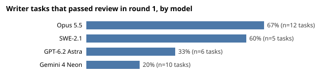
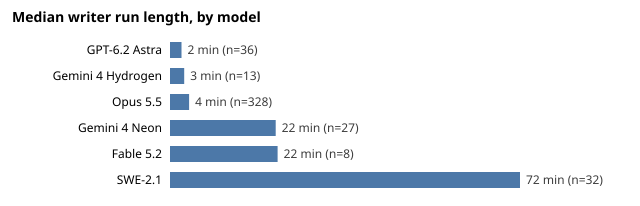

# Agent benchmark: which model, at which effort, for which work

A record of how AI coding agents performed on one real project: BuildMed's port of a laparoscopic surgery simulator from Unity to Unreal Engine 5, built almost entirely by agents from 2026-11-21. Every run is a real task (C++ engine code, physics, rendering, tools, CI, tests, 3D assets, reviews and council votes), not a benchmark prompt. The data is refreshed every night from the project's own metrics.

- [methodology.md](methodology.md): where the numbers come from, how runs are joined to outcomes, and what they can't tell you.
- [workflow.md](workflow.md): the pipeline the agents worked in (plan, write, review, council, land).
- [lessons.md](lessons.md): incidents with numbers, and the routing rules they produced, including the 2026-11-28 swarm.
- [external.md](external.md): third-party benchmarks of the same models, kept separate and cited.
- `data/`: the sanitised runs and landing CI as JSONL. `scripts/build.py` rebuilds every table and chart below from `data/` alone.

## Findings (as of 2026-11-28)

Sample sizes are small. Effort was chosen by task difficulty, so higher effort often means harder work, not worse results. Read the rows as a ranking. Outcomes are counted per task (one PR), not per session.

1. **Opus 5.5 at `medium` was the most dependable general writer.** 7 of 11 tasks passed their first independent review (64%), averaging 1.36 rounds, and 4 of 4 passed landing CI first time. The project's earlier studies agree: 6 of 11 and then 7 of 14 first-review passes, the best of any writer under the strictest reviewer.
2. **More effort did not buy better first reviews for Opus.** At `high`, 3 of 5 tasks passed round 1; in the earlier study 4 of 12 did, against 6 of 11 at `medium`. `high` went to harder work, but it never showed a clear gain, so `medium` became the default and `high` was kept for UI design.
3. **GPT-6.2 Astra and Sol were good on well-defined work and weak on open-ended work.** On comment clean-ups and quick-fix batches they passed 9 of 10 and 6 of 8 first reviews. On physics and rendering in this data Astra passed round 1 on 3 of 6 tasks, and only 1 of 4 of its physics tasks passed landing CI first time.
4. **Gemini 4 Neon wrote code that needed rework.** 2 of 10 tasks passed round 1 (mean 1.8 rounds) at `high`, though 9 of 11 passed landing CI first time once reviewed. The earlier study found real bugs behind the failures: a broken default build, a Windows build that wouldn't compile, and a test that could never fail.
5. **SWE-2.1 (Devin) at `max` did well but slowly.** 3 of 4 tasks passed round 1 and 3 of 4 passed landing CI first time, at a median 57 minutes per session. At `high`, 1 of 2 passed round 1 and its sessions ran a median 117 minutes. One task took eight SWE-2.1 sessions before a FAIL and then a PASS; it landed.
6. **Sonnet 5.5 and Gemini 4 Argon were dropped as writers.** In the first study Sonnet passed 1 of 6 first reviews and needed 4 to 6 rounds; Argon passed 0 of 2 and needed 7. Their PRs shipped broken builds, tests that couldn't fail and races.
7. **GPT-6.2 Sol at `medium` was the strictest reviewer, and its blockers were real.** It failed all 10 of its recorded `medium` reviews here. In the studies nearly all its round-1 blockers were normal-path bugs, usually reproduced first; at `high` it caught no more than at `medium`, and at `low` it was enough for fix-only re-checks. Opus 5.5 at `low` passed 5 of 5 re-checks.
8. **Neon passed work that a stronger reviewer later failed.** It passed 4 of 8 reviews at `high`, and one pass hid a 13° shading seam that Sol found at the council. Since then, physics and look work gets a second reviewer from another model family.
9. **Gemini 4 Hydrogen wrote small, fully specified slices fast.** In the 2026-11-28 swarm it finished 11 of 11 slices from frozen interfaces at a median of about 6 minutes each, and 9 of them needed no fixes (lessons.md). Independent long-horizon benchmarks rank it low (external.md), so it was trusted only where the interface was already fixed.
10. **Landing CI passed first time on 44 of 49 runs (90%),** at about 10 minutes median, once every push had to pass a local pre-push check first.

## Tables

The block below is generated by `scripts/build.py`; edit the data, not the block.

<!-- benchmark:tables -->
583 agent runs (2026-11-21 to 2026-11-28): 1 auditor, 34 council seat, 3 fixer, 16 planner, 8 researcher, 60 reviewer, 461 writer. 161 of 461 writer runs have a known review outcome. 49 landing CI runs.

† fewer than 5 runs: read as an anecdote, not a rate. – means no observation.

### Writers

| model | effort | runs | tasks | landed | passed round 1 | mean rounds to pass | landing CI first pass | third-fail stops | median minutes | median tokens | limit hits |
|---|---|---|---|---|---|---|---|---|---|---|---|
| Fable 5.2 | high | 8 | 3 | 3/3 (100%) | 2/3 (67%) | 1.33 | 1/1 (100%) | 0 | 22.0 | 7818k | 0 |
| GPT-6.2 Astra | medium | 21 | 7 | 5/5 (100%) | 1/4 (25%) | 1.75 | 3/5 (60%) | 0 | 1.8 | 877k | 0 |
| GPT-6.2 Astra | high | 15 | 6 | 4/4 (100%) | 2/4 (50%) | 1.50 | 1/2 (50%) | 0 | 2.9 | 2758k | 0 |
| GPT-6.2 Sol | medium | 1 † | 1 | 1/1 (100%) | 0/1 (0%) | 2.00 | 1/1 (100%) | 0 | 1.5 | 725k | 0 |
| Gemini 4 Argon | high | 2 † | 1 | 1/1 (100%) | 1/1 (100%) | 1.00 | – | 0 | 22.6 | – | 0 |
| Gemini 4 Hydrogen | high | 13 | 6 | – | – | – | – | 0 | 2.9 | 1644k | 0 |
| Gemini 4 Neon | high | 27 | 12 | 11/11 (100%) | 2/10 (20%) | 1.80 | 9/11 (82%) | 0 | 21.6 | 7384k | 0 |
| Opus 5.5 | medium | 68 | 18 | 11/11 (100%) | 7/11 (64%) | 1.36 | 4/4 (100%) | 0 | 15.9 | 7133k | 0 |
| Opus 5.5 | high | 260 | 9 | 6/6 (100%) | 3/5 (60%) | 1.40 | 3/3 (100%) | 0 | 2.7 | 1218k | 1 |
| SWE-2.1 | high | 21 | 8 | 2/2 (100%) | 1/2 (50%) | 1.50 | 0/2 (0%) | 0 | 116.5 | – | 0 |
| SWE-2.1 | max | 11 | 8 | 4/4 (100%) | 3/4 (75%) | 1.25 | 3/4 (75%) | 0 | 57.2 | – | 0 |
| Sonnet 5.5 | low | 2 † | 2 | 0/2 (0%) | 2/2 (100%) | 1.00 | – | 0 | – | – | 0 |
| – | – | 12 | 3 | 3/3 (100%) | 2/2 (100%) | 1.00 | – | 0 | 35.8 | – | 0 |

### Reviewers

| model | effort | runs | verdict pass | missed a defect | false blockers | median minutes |
|---|---|---|---|---|---|---|
| GPT-6.2 Astra | low | 1 † | 1/1 (100%) | – | – | 0.6 |
| GPT-6.2 Astra | medium | 5 | 0/2 (0%) | – | – | 1.3 |
| GPT-6.2 Astra | high | 1 † | – | – | – | 2.7 |
| GPT-6.2 Astra | – | 1 † | – | – | – | – |
| GPT-6.2 Sol | low | 3 † | 3/3 (100%) | – | – | 0.4 |
| GPT-6.2 Sol | medium | 12 | 0/10 (0%) | – | – | 4.1 |
| GPT-6.2 Sol | – | 4 † | 1/3 (33%) | – | – | – |
| Gemini 4 Hydrogen | high | 2 † | – | – | – | 4.3 |
| Gemini 4 Neon | low | 2 † | 2/2 (100%) | – | – | 0.5 |
| Gemini 4 Neon | medium | 5 | 3/4 (75%) | – | – | 1.6 |
| Gemini 4 Neon | high | 9 | 4/8 (50%) | – | – | 7.5 |
| Gemini 4 Neon | – | 4 † | 2/3 (67%) | 1/1 (100%) | – | – |
| Opus 5.5 | low | 5 | 5/5 (100%) | – | – | 0.6 |
| Opus 5.5 | medium | 3 † | 1/2 (50%) | – | – | 3.0 |
| Opus 5.5 | high | 1 † | – | – | – | 2.5 |
| Sonnet 5.5 | – | 2 † | 1/1 (100%) | – | – | – |

More tables: [writers by task type](tables/writers-by-task.md), [reviewers by tier](tables/reviewers.md), [council](tables/council.md), [harness](tables/harness.md), [other roles](tables/other-roles.md), [landing CI](tables/landings.md).
<!-- /benchmark:tables -->

## Licence

The data and the write-ups are under [CC BY 4.0](LICENSE). The scripts in `scripts/` are under the [MIT licence](scripts/LICENSE).
